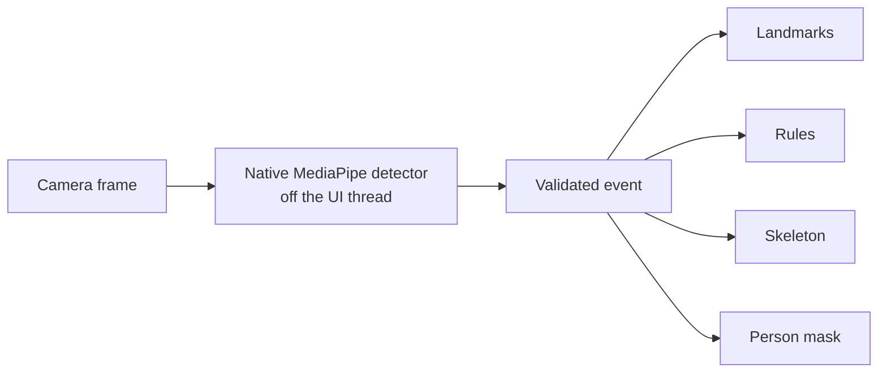

# expo-mediapipe-pose

<picture>
  <source media="(prefers-color-scheme: dark)" srcset=".github/hero-dark.svg">
  
</picture>

On-device pose tracking for [Expo](https://docs.expo.dev/) and [React Native](https://reactnative.dev/), built on Google's [MediaPipe Pose Landmarker](https://ai.google.dev/edge/mediapipe/solutions/vision/pose_landmarker). Community project, not an official Google or Expo package.

## Why

Pose tracking in a phone app usually means one of two things: send camera frames to a server, or wire the MediaPipe iOS and Android SDKs into React Native yourself. This library does the second part once. You get one camera component, typed events and a few hooks. Frames stay on the phone: nothing is uploaded and no model is downloaded.

## Features

- A camera view that draws a styled skeleton over 33 named landmarks.
- Rules you write yourself (`usePoseRule`) with confidence checks, hold time and an explicit `unknown` status.
- Named angles and distances between landmarks, in image or world coordinates.
- Photo and video analysis from local files.
- Up to six poses per frame, with a person mask per pose when you ask for it.
- Record and replay landmark sessions (pose data, not video).
- Camera and frame-rate discovery, with separate preview, inference and callback rates.
- A pure `expo-mediapipe-pose/core` entry point for logic and tests that does not load React Native.

## How it works



Swift (iOS) and Kotlin (Android) capture frames and run the detector on their own thread. Each result crosses to JavaScript as one event, and a zod schema checks it before your code sees it. Events from an old camera session are dropped after a stop or reconfigure. Everything after that (rules, skeleton drawing, geometry) is plain TypeScript.

## Install

```sh
pnpm add expo-mediapipe-pose
pnpm exec expo install react-native-svg expo-camera
```

Add the camera permission text to your app config, then make a development build. [Expo Go](https://expo.dev/go) cannot load this native module.

```json
{
  "expo": {
    "plugins": [
      ["expo-camera", {
        "cameraPermission": "Allow camera access for on-device pose tracking.",
        "recordAudioAndroid": false
      }]
    ]
  }
}
```

```sh
pnpm exec expo run:ios
# or: pnpm exec expo run:android
```

Version 0.5.0 targets Expo SDK 58, React Native 0.88 and React 19.3. Its peer ranges also allow SDK 57, React Native 0.86 and React 19.2. Upgrading from 0.4? Read the [0.5.0 breaking changes](CHANGELOG.md): the old mask names are now "person mask" names.

## Hello world

[hello-world/](hello-world/) is a small Expo app with one screen. It asks for the camera, draws the skeleton and turns it green when both hands are above your nose. `app.tsx` has numbered comments, 1 to 6, that you read top to bottom:

1. Install the packages.
2. Ask for the camera with `useCameraPermissions`.
3. Write a condition with `usePoseRule`.
4. Read the landmarks in a frame handler.
5. Show the camera with `PoseCameraView`.
6. Color the skeleton by the rule status.

[hello-world/README.md](hello-world/README.md) says how to run it. The [larger example app](example/app.tsx) adds camera switching, pause and resume, photo and video analysis, replay and error recovery.

## Guides

### Show a pose camera

Mount it after permission is granted. It fills its layout and draws the skeleton by default.

```tsx
import { PoseCameraView } from "expo-mediapipe-pose";

<PoseCameraView
  style={{ flex: 1 }}
  cameraFacing="front"
  frameLimit={15}
  onLandmark={frame => handlePose(frame.landmarks)}
  onInferenceError={error => showCameraError(error.code)}
/>
```

Set `isActive={false}` when the screen loses focus to release the camera and keep the component mounted. `previewFps`, `frameLimit` and `callbackFps` set the capture, inference and JavaScript rates on their own.

### Style joints and body parts

```tsx
<PoseCameraView
  style={{ flex: 1 }}
  skeleton={{
    bodyParts: ["leftArm", "rightArm", "torso"],
    color: "#38bdf8",
    jointRadius: 5,
    lineWidth: 3,
    joints: { leftWrist: { color: "#f59e0b", radius: 8 } },
    connections: { "leftElbow:leftWrist": { color: "#f59e0b" } },
  }}
/>
```

Choosing body parts changes the drawing, not the detector or the landmarks you receive. One joint's style beats the global style. Pass `skeleton={false}` to draw your own overlay.

### React to a condition

Your app writes the condition. `usePoseRule` checks confidence, hold time and stale input, and calls you only when the status changes.

```tsx
const feedbackColors = {
  pass: "#22c55e",
  fail: "#ef4444",
  unknown: "#94a3b8",
};

const raisedArm = usePoseRule({
  landmarks: ["leftWrist", "leftShoulder"],
  minVisibility: 0.6,
  holdMs: 250,
  isActive: screenIsFocused,
  evaluate: pose => pose.leftWrist.y < pose.leftShoulder.y,
  onChange: status => handleArmStateChange(status),
});

<PoseCameraView
  style={{ flex: 1 }}
  isActive={screenIsFocused}
  onLandmark={raisedArm.update}
  onCameraConfigured={raisedArm.reset}
  onInferenceError={raisedArm.reset}
  skeleton={{ bodyParts: ["leftArm"], color: feedbackColors[raisedArm.status] }}
/>
```

Missing, uncertain or stale landmarks give `unknown`, which is not the same as a failed condition. Use `usePoseRules` for several conditions at once. For logic and tests without a native view, import the pure helpers:

```ts
import { getLandmark } from "expo-mediapipe-pose/core";

const leftWrist = getLandmark(frame, "leftWrist");
```

### Angles and distances

```ts
import { getImageJointAngle } from "expo-mediapipe-pose/core";

const input = { landmarks: frame.landmarks, imageSize: frame.imageSize };
const elbow = getImageJointAngle(input, "leftShoulder", "leftElbow", "leftWrist", { minVisibility: 0.6 });
if (elbow.status === "available") use(elbow.value); // degrees
```

A result is `{ status: "available", value, unit }` or `{ status: "unavailable", reason }`. Handle both.

### Photos and videos

```ts
const detection = await analyzePoseImage(localFileUri, { maxPoses: 2 });

for await (const sample of analyzePoseVideo(localVideoUri, { samplingFps: 5, signal, onProgress })) {
  handle(sample.detection, sample.timestampMs);
}
```

Inputs are local file locations. Video is sampled, and `signal` (an `AbortSignal`) cancels it.

### Record and replay

```ts
const recorder = createPoseRecorder({ maxFrames: 1800 });
recorder.start();
recorder.append(frame); // from onLandmark
const recording = recorder.stop();
const text = serializePoseRecording(recording); // parsePoseRecording(text) reads it back
```

Replay with `usePoseReplay(recording, { onFrame, onReset, onStateChange })`, or `createPoseReplay` outside React. Recordings hold landmarks and metadata, not camera video or person masks.

### Person mask

Set `personMaskEnabled` on the camera or on a photo or video call, then draw each pose's mask with `PosePersonMaskOverlay`. At most two mask results can be open per module. Call `releasePosePersonMask` when you finish with one, including on errors and on unmount. The overlay does not release them for you.

### Several poses

`maxPoses` allows up to six poses. `poseIndex` and `selectPose` pick one pose from a result. An index is not a person identity across frames, so reset rules and tracking when your selection changes.

## API reference

Everything below comes from `expo-mediapipe-pose`. Names marked "core" are also in `expo-mediapipe-pose/core`, which has no React Native dependency.

### Camera

| Export | What it does |
|---|---|
| `PoseCameraView`, `PoseCameraViewProps` | The camera component with skeleton, events and rate props. |
| `getCameraCapabilities` | Lists the cameras and frame rates the phone supports. |
| `CameraCapabilities`, `CameraCapability`, `CameraConfiguration`, `CameraFacing`, `CameraLens` (core) | Schemas and types for camera discovery and the applied configuration. |
| `findCameraCapability`, `validateFrameRates`, `getOverlayStaleAfterMs`, `FrameRates` (core) | Pick a camera and check requested rates. |
| `InferenceError`, `PosePerformanceMetrics` (core) | Error and timing events from the native side. |

### Skeleton

| Export | What it does |
|---|---|
| `PoseSkeleton`, `PoseSkeletonProps` | Draws a skeleton over your own view. |
| `createSkeleton`, `createDetectionSkeleton`, `projectLandmark` (core) | Build skeleton shapes and project a landmark to preview pixels. |
| `SkeletonOptions`, `JointStyle`, `ConnectionStyle`, `Dimensions` (core) | Skeleton style types. |
| `selectPose`, `SelectablePose` (core) | Pick one pose from a multi-pose result. |

### Landmarks and measurement

| Export | What it does |
|---|---|
| `LANDMARK_NAMES`, `POSE_CONNECTIONS`, `BODY_PARTS`, `LandmarkName`, `ConnectionName`, `BodyPart` (core) | The 33 landmark names, skeleton lines and body-part groups. |
| `getLandmark`, `getNamedLandmarks` (core) | Read landmarks by name. |
| `Landmark`, `PoseLandmarks`, `PoseResults`, `PoseFrame`, `MaxPoses`, `ModelVariant` (core) | Result schemas and types. |
| `getImageJointAngle`, `getImageDistance`, `getWorldJointAngle`, `getWorldDistance` (core) | Angles in degrees and distances in pixels or meters. |
| `GeometryOptions`, `ImageGeometryInput`, `WorldGeometryInput`, `PoseMeasurement`, `UnavailableMeasurement`, `MeasurementUnit` (core) | Measurement input and result types. |

### Rules and tracking

| Export | What it does |
|---|---|
| `usePoseRule`, `usePoseRules` | React hooks for one or several rules. |
| `definePoseRule`, `evaluatePoseRule`, `advancePoseRule`, `initialPoseRuleState`, `validatePoseRuleOptions` (core) | The same rules outside React. |
| `PoseRuleOptions`, `PoseRuleState`, `PoseRuleStatus` (core) | Rule types. Status is `pass`, `fail` or `unknown`. |
| `createThresholdRule`, `evaluatePoseThreshold`, `PoseThreshold`, `ThresholdRuleOptions` (core) | Threshold rules with hysteresis. |
| `composeSkeletonFeedback`, `SkeletonAppearance`, `SkeletonFeedback` (core) | Combine rule results into skeleton styles. |
| `usePoseTracking`, `inspectPoseTracking`, `trackingState`, `PoseTrackingOptions`, `PoseTrackingState`, `PoseTrackingStatus` | Whether a pose is present and steady. The hook is main entry only. |

### Photos and videos

| Export | What it does |
|---|---|
| `analyzePoseImage` | Detect poses in one local image. |
| `analyzePoseVideo` | Sample a local video and yield detections, with cancel and progress. |
| `PoseImageOptions`, `PoseDetection`, `resolvePoseImageOptions`, `validateLocalFileLocation` (core) | Image options and results. |
| `PoseVideoSampling`, `PoseVideoFrame`, `PoseVideoOptions`, `PoseVideoProgress`, `resolvePoseVideoOptions`, `createVideoSamplePlan` (core) | Video options, sample plan and progress. |

### Person mask

| Export | What it does |
|---|---|
| `PosePersonMask`, `PosePersonMaskImage`, `MaskMaxDimension` (core) | The mask schemas and the size limit. |
| `PosePersonMaskOverlay`, `PosePersonMaskOverlayProps` | Draws one pose's mask. |
| `releasePosePersonMask` | Gives a mask back so it can be freed. |

### Record and replay

| Export | What it does |
|---|---|
| `createPoseRecorder`, `createPoseDetectionRecorder`, `copyPoseRecording`, `copyPoseDetectionRecording` (core) | Bounded recorders and copies. |
| `serializePoseRecording`, `parsePoseRecording`, `serializePoseDetectionRecording`, `parsePoseDetectionRecording`, `PoseRecording`, `PoseDetectionRecording`, `PoseRecorderStatus` (core) | Save and load recordings. |
| `usePoseReplay`, `createPoseReplay`, `createPoseDetectionReplay`, `PoseReplay`, `PoseReplayCallbacks`, `PoseReplayState`, `PoseReplayStatus` | Play a recording back. The hook is main entry only. |

## Platforms and limits

- iOS and Android development builds only. Expo Go and browsers are not supported. A bare React Native app needs [Expo modules installed](https://docs.expo.dev/bare/installing-expo-modules/).
- Only the full pose model is bundled. Lite and heavy need a local model file.
- Pose indices are not persistent identities.
- The library does not count reps, score exercises or judge medical accuracy. Your app does that.
- Native builds, behavior tests and public photo and video fixtures check the integration. They do not prove physical-camera alignment or long-session speed.

## FAQ

<details>
<summary>What does it add to MediaPipe?</summary>

A React Native camera component, typed events, skeleton styling, named geometry, rule hooks, photo and video analysis and person mask ownership. It uses Google's official MediaPipe Tasks SDKs and model as they are, so it adds no new model and claims no better accuracy.

</details>

<details>
<summary>Is it a drop-in replacement for ThinkSys/mediapipe-reactnative?</summary>

No. Replace `RNMediapipe` with `PoseCameraView`, use the camera props and `SkeletonOptions`, then rebuild and check your overlay coordinates.

</details>

<details>
<summary>Can I use it from a Swift-only or Kotlin-only app?</summary>

No. The Swift and Kotlin code is the Expo bridge, not a separate SDK. For a fully native app, start with Google's [iOS](https://ai.google.dev/edge/mediapipe/solutions/vision/pose_landmarker/ios) or [Android](https://ai.google.dev/edge/mediapipe/solutions/vision/pose_landmarker/android) guide.

</details>

<details>
<summary>Do frames leave the phone?</summary>

No. Inference runs on the phone, and the library uploads nothing and downloads no model. Recordings hold landmarks and metadata, not camera video.

</details>

<details>
<summary>Does a pose index follow the same person across frames?</summary>

No. `poseIndex` picks within one result only. Reset rules and tracking when your selection changes.

</details>

<details>
<summary>Why do person mask results report backpressure?</summary>

At most two mask leases can be open per module. Call `releasePosePersonMask` when you finish with one, including on errors and unmount.

</details>

<details>
<summary>How do I add the Agent Skill to my coding agent?</summary>

The repo ships an [Agent Skill](skills/expo-mediapipe-pose/SKILL.md) with install steps, a minimal camera, common tasks and common mistakes:

```sh
npx skills add YosefHayim/expo-mediapipe-pose
```

[llms.txt](llms.txt) is a short reading list for tools that accept it.

</details>

## Contributing

Use Node 24 (`nvm use`) and the pinned pnpm.

```sh
pnpm install --frozen-lockfile
pnpm check
```

`pnpm check` runs [Biome](https://biomejs.dev/), [knip](https://knip.dev/), typecheck, tests and builds through [Turborepo](https://turborepo.dev/). The [native fixture runner](example/fixtures/README.md) runs real SDK inference on public images and videos. Read [AGENTS.md](AGENTS.md) for the folder layout and the rules for changes. Report bugs with device, OS, SDK and model details in [GitHub Issues](https://github.com/YosefHayim/expo-mediapipe-pose/issues).

## License

[MIT](LICENSE). This project grew from [ThinkSys/mediapipe-reactnative](https://github.com/ThinkSys/mediapipe-reactnative); its attribution and the MediaPipe notices are kept in [third-party notices](THIRD_PARTY_NOTICES.md). The native inference SDKs and the pose model come from Google.
